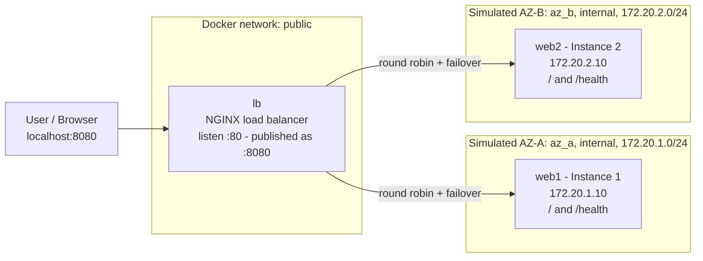
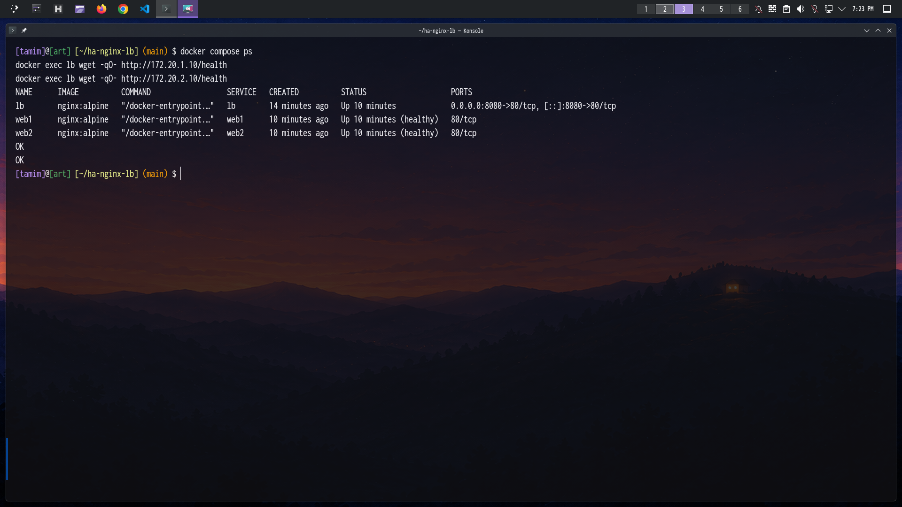
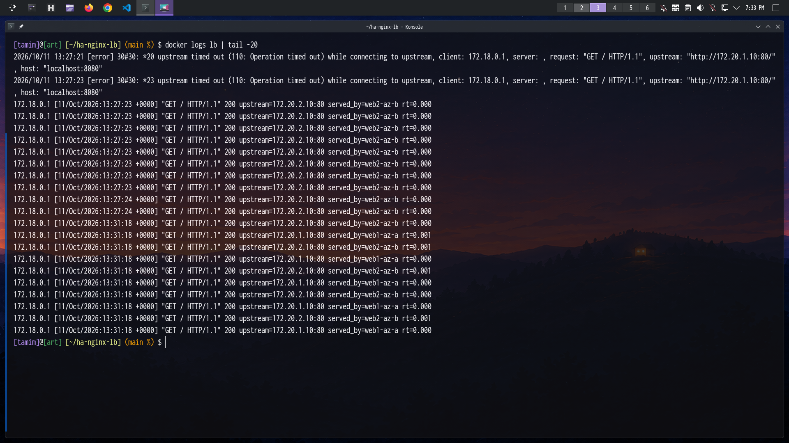

# High-Availability Web Service with Load Balancing

**Name:** Tamim
**Student ID:** `<YOUR-STUDENT-ID>`
**Chosen option:** **Option B – NGINX Load Balancer (local, Docker)**

A highly available web service for the fictional start-up ShopFast. An open-source NGINX load balancer distributes traffic across two web servers placed in two simulated Availability Zones. If one server (or a whole simulated AZ) fails, users keep getting normal responses, and the server is brought back into rotation automatically once it recovers.

---

## Table of Contents

1. [Problem 1 – Architecture](#problem-1--architecture)
2. [Problem 2 – The Two Instances](#problem-2--the-two-instances)
3. [Problem 3 – The Load Balancer](#problem-3--the-load-balancer)
4. [Problem 4 – Health Checks](#problem-4--health-checks)
5. [Reproduce the Setup](#reproduce-the-setup)
6. [Problem 5 – Failure Testing and Proof of Work](#problem-5--failure-testing-and-proof-of-work)
7. [Problem 6 – Reflection](#problem-6--reflection)

---

## Problem 1 – Architecture

### Diagram



### Role of each component

| Component | Role |
|---|---|
| **User** | Sends HTTP requests to `http://localhost:8080`. Only ever talks to the load balancer. |
| **lb (NGINX)** | The single entry point. Distributes requests across both instances, detects failed servers, retries failed requests on the healthy server, and logs which instance served each request. Attached to all three networks so it can reach both AZs and be reached by users. |
| **web1 (Instance 1, AZ-A)** | NGINX web server returning a page that says "Instance 1 – AZ-A", plus a `/health` endpoint. Lives only in `az_a`. |
| **web2 (Instance 2, AZ-B)** | Same as web1 but returns "Instance 2 – AZ-B". Lives only in `az_b`. |
| **az_a / az_b networks** | Two separate Docker bridge networks (`internal: true`), each acting as an isolated Availability Zone. |
| **public network** | Network used by the load balancer to publish port 8080 to the host. |

### AWS to local mapping

| AWS component | Local equivalent in this project |
|---|---|
| Application Load Balancer | NGINX container `lb` |
| Listener (port 80) | `listen 80;` in the `server` block of `lb/nginx.conf` (published as host port 8080) |
| Availability Zone | Separate Docker network (`az_a`, `az_b`) with its own subnet |
| EC2 instance | Container (`web1`, `web2`) running `nginx:alpine` |
| Target Group | `upstream app { ... }` block in `lb/nginx.conf` |
| Health Check | `max_fails` / `fail_timeout` (passive) + `proxy_next_upstream` retries |
| Security Group | No published ports on the web containers + `internal: true` networks |

### How the two simulated AZs are isolated

- Each AZ is its own Docker bridge network with its own subnet (`172.20.1.0/24` and `172.20.2.0/24`).
- `web1` is attached **only** to `az_a`, `web2` **only** to `az_b`, so the two instances cannot talk to each other.
- Both AZ networks are `internal: true`: no route to or from the outside world.
- The web containers publish **no ports** to the host. The only published port in the whole project is `8080` on the load balancer.
- Only the load balancer is attached to both AZ networks, which is what lets it reach both instances.
- Stopping or removing one AZ's container has no effect on the other.

---

## Problem 2 – The Two Instances

Both instances are `nginx:alpine` containers with a custom config and page:

| | Instance 1 | Instance 2 |
|---|---|---|
| Container | `web1` | `web2` |
| AZ / network | AZ-A / `az_a` | AZ-B / `az_b` |
| IP | `172.20.1.10` | `172.20.2.10` |
| Page | "Instance 1 – AZ-A" | "Instance 2 – AZ-B" |
| Health endpoint | `/health` returns `200 OK` | `/health` returns `200 OK` |
| Identifying header | `X-Served-By: web1-az-a` | `X-Served-By: web2-az-b` |

- Each container also has a Docker `healthcheck` that calls `http://127.0.0.1/health`, so `docker compose ps` shows `(healthy)`.
- **Instances only accept traffic through the load balancer:** they publish no ports and sit on internal networks, so the only way in from outside is `lb:8080`.

### Isolation proof

A throwaway "user" container on the `public` network can reach the load balancer but not the web servers directly:

```bash
docker run --rm --network ha-nginx-lb_public nginx:alpine wget -T3 -qO- http://lb
docker run --rm --network ha-nginx-lb_public nginx:alpine wget -T3 -qO- http://172.20.1.10 || echo "web1 blocked"
docker run --rm --network ha-nginx-lb_public nginx:alpine wget -T3 -qO- http://172.20.2.10 || echo "web2 blocked"
docker port web1 web2
docker network inspect ha-nginx-lb_az_a --format 'Internal={{.Internal}}'
```


> **Note:** On Linux the Docker host itself has an interface on every bridge network, so running `curl 172.20.1.10` directly on the host machine still works. This is normal host behaviour. The isolation boundary that matters is for external clients: they can only reach the instances through the load balancer, as shown above.

---

## Problem 3 – The Load Balancer

- The load balancer is the **only entry point**: it is the only container with a published port (`8080:80`).
- Requests are distributed across both instances using NGINX's default **round-robin** method.
- The serving instance is identifiable in two ways: the page content ("Instance 1 – AZ-A" or "Instance 2 – AZ-B") and the `X-Served-By` response header, which the load balancer passes through from the upstream.
- The load balancer access log also records `upstream=` (the IP that served the request) and `served_by=` for every request.

Key part of `lb/nginx.conf`:

```nginx
upstream app {
    server 172.20.1.10:80 max_fails=2 fail_timeout=10s;
    server 172.20.2.10:80 max_fails=2 fail_timeout=10s;
}

server {
    listen 80;

    location / {
        proxy_pass http://app;
        proxy_connect_timeout 2s;
        proxy_read_timeout 5s;
        proxy_next_upstream error timeout http_502 http_503 http_504;
        proxy_next_upstream_tries 2;
        add_header X-Served-By $upstream_http_x_served_by always;
    }
}
```

---

## Problem 4 – Health Checks

### (a) and (b) Automatic removal, recovery, and no error pages

- **Removal:** if requests to a server fail (connection refused, timeout, 502/503/504) `max_fails` times within `fail_timeout`, NGINX marks it unavailable and stops routing to it.
- **No error pages:** `proxy_next_upstream` makes NGINX retry a failed request on the other server before answering the user, so the user still receives a normal `200` page.
- **Recovery:** after `fail_timeout` has passed, NGINX lets a real request through to the failed server. If it succeeds, the server is back in rotation automatically, with no manual step.

### (c) Chosen values and justification

| Setting | Value | Justification |
|---|---|---|
| Health path | `/health` | A cheap, dedicated endpoint independent of page content, with logging disabled so it doesn't pollute the access log. Used by the container healthcheck and for manual verification. |
| `max_fails` | `2` | A single failed request could be a transient blip, so one failure shouldn't eject a server. Two keeps the system stable but still reacts quickly. |
| `fail_timeout` | `10s` | Serves two purposes: the window in which failures are counted, and how long the server stays out before NGINX tries it again. It therefore sets the recovery time. 10 seconds is short enough for fast recovery but long enough not to hammer a dead server. |
| `proxy_connect_timeout` | `2s` | A stopped server refuses or times out immediately. Failing fast means users aren't left waiting before the retry. |
| `proxy_read_timeout` | `5s` | Allows normal responses but cuts off hung backends so the request can be retried elsewhere. |
| `proxy_next_upstream` | `error timeout http_502 http_503 http_504` | Covers the realistic failure modes of a crashed or overloaded backend, so those requests are retried transparently. |
| `proxy_next_upstream_tries` | `2` | With two servers, one retry on the other AZ is enough. More would only add latency. |
| Docker healthcheck | interval 5s, timeout 2s, retries 2 | Gives fast, visible container health status for `docker compose ps` and for startup ordering (`lb` starts only after both instances are healthy). |

### (d) Active vs passive health checks

- **Active health checks:** the load balancer itself sends periodic probe requests (for example `GET /health` every few seconds) to each backend, independent of user traffic. A backend is marked down or up based on the probe results. This detects failures before any user is affected.
- **Passive health checks:** the load balancer watches the results of real user requests. If requests to a backend fail, it marks that backend as unhealthy. There are no extra probes, but a real user request is what discovers the failure, which is why retries (`proxy_next_upstream`) are needed to hide it.

**Open-source NGINX uses passive health checks** (`max_fails` / `fail_timeout`). Active health checks (the `health_check` directive) are an NGINX Plus (commercial) feature. The AWS ALB, by contrast, uses active checks via its Target Group configuration. The Docker `healthcheck` in this project is an active check, but it only reports container status and does not influence NGINX's routing.

---

## Reproduce the Setup

**Prerequisites:** Docker and Docker Compose.

```bash
# 1. Clone
git clone https://github.com/<your-username>/<repository-name>.git
cd <repository-name>

# 2. Start everything
docker compose up -d

# 3. Wait until both web containers show (healthy) and lb is running
docker compose ps

# 4. Test
curl -s localhost:8080
```

### Project layout

```
.
├── docker-compose.yml     # 3 services, 3 networks, static IPs
├── lb/
│   └── nginx.conf         # Load balancer config
├── web1/
│   ├── default.conf       # Instance 1 server config + /health
│   └── index.html         # "Instance 1 – AZ-A"
├── web2/
│   ├── default.conf       # Instance 2 server config + /health
│   └── index.html         # "Instance 2 – AZ-B"
├── screenshots/           # Proof of work
└── README.md
```

### Configuration files

#### `docker-compose.yml`

```yaml
services:
  web1:
    image: nginx:alpine
    container_name: web1
    volumes:
      - ./web1/index.html:/usr/share/nginx/html/index.html:ro
      - ./web1/default.conf:/etc/nginx/conf.d/default.conf:ro
    networks:
      az_a:
        ipv4_address: 172.20.1.10
    healthcheck:
      test: ["CMD", "wget", "-qO-", "http://127.0.0.1/health"]
      interval: 5s
      timeout: 2s
      retries: 2

  web2:
    image: nginx:alpine
    container_name: web2
    volumes:
      - ./web2/index.html:/usr/share/nginx/html/index.html:ro
      - ./web2/default.conf:/etc/nginx/conf.d/default.conf:ro
    networks:
      az_b:
        ipv4_address: 172.20.2.10
    healthcheck:
      test: ["CMD", "wget", "-qO-", "http://127.0.0.1/health"]
      interval: 5s
      timeout: 2s
      retries: 2

  lb:
    image: nginx:alpine
    container_name: lb
    ports:
      - "8080:80"
    volumes:
      - ./lb/nginx.conf:/etc/nginx/nginx.conf:ro
    depends_on:
      web1:
        condition: service_healthy
      web2:
        condition: service_healthy
    networks:
      - az_a
      - az_b
      - public

networks:
  az_a:
    internal: true
    ipam:
      config:
        - subnet: 172.20.1.0/24
  az_b:
    internal: true
    ipam:
      config:
        - subnet: 172.20.2.0/24
  public:
```

#### `web1/default.conf` (web2 is identical except `X-Served-By "web2-az-b"`)

```nginx
server {
    listen 80;

    add_header X-Served-By "web1-az-a" always;

    location / {
        root /usr/share/nginx/html;
        index index.html;
    }

    location /health {
        access_log off;
        default_type text/plain;
        return 200 "OK\n";
    }
}
```

#### `lb/nginx.conf`

```nginx
events {}

http {
    log_format lb '$remote_addr [$time_local] "$request" $status '
                  'upstream=$upstream_addr served_by=$upstream_http_x_served_by '
                  'rt=$request_time';
    access_log /var/log/nginx/access.log lb;

    upstream app {
        server 172.20.1.10:80 max_fails=2 fail_timeout=10s;
        server 172.20.2.10:80 max_fails=2 fail_timeout=10s;
    }

    server {
        listen 80;

        location / {
            proxy_pass http://app;
            proxy_connect_timeout 2s;
            proxy_read_timeout 5s;
            proxy_next_upstream error timeout http_502 http_503 http_504;
            proxy_next_upstream_tries 2;
            add_header X-Served-By $upstream_http_x_served_by always;
        }
    }
}
```

### Clean up

```bash
docker compose down
```

---

## Problem 5 – Failure Testing and Proof of Work

### T1 – Health status

**Steps:**

```bash
docker compose ps
docker exec lb wget -qO- http://172.20.1.10/health
docker exec lb wget -qO- http://172.20.2.10/health
```



**Result:** Both `web1` and `web2` show `(healthy)`, and both `/health` endpoints return `OK` when called from the load balancer.

### T2 – Load distribution

**Steps:**

```bash
for i in $(seq 1 10); do curl -s -D - -o /dev/null localhost:8080 | grep -i x-served-by; done
```


**Result:** Ten consecutive requests alternate between `web1-az-a` and `web2-az-b`, showing round-robin distribution across both instances.

### T3 – Browser test

**Steps:** Open `http://localhost:8080` in a browser and refresh several times.


**Result:** The page alternates between "Instance 1 – AZ-A" and "Instance 2 – AZ-B" on refresh.

### T4 – AZ failure

**Steps:**

```bash
docker stop web1
for i in $(seq 1 15); do curl -s -o /dev/null -w "%{http_code} " localhost:8080; done; echo
for i in $(seq 1 10); do curl -s -D - -o /dev/null localhost:8080 | grep -i x-served-by; done
docker compose ps
```


**Result:** With `web1` (AZ-A) stopped, every request still returns `200`, and every response comes from `web2-az-b`. The first requests after the failure are retried on AZ-B by `proxy_next_upstream`, so users see no error. After `max_fails` failures NGINX stops sending traffic to the failed instance entirely.

### T5 – Recovery

**Steps:**

```bash
docker start web1
sleep 15
for i in $(seq 1 10); do curl -s -D - -o /dev/null localhost:8080 | grep -i x-served-by; done
```


**Result:** After `web1` is started and `fail_timeout` (10s) has passed, NGINX tries it again, finds it healthy, and traffic is shared between both instances automatically, with no manual action on the load balancer.

### T6 – Logs / monitoring

**Steps:**

```bash
docker logs lb | tail -40
```



**Result:** The access log shows the `upstream=` address and `served_by=` value for each request. Requests reach both instances, only AZ-B appears during the failure window, and AZ-A reappears after recovery.

---

## Problem 6 – Reflection

### (a) AWS ALB vs. NGINX

AWS ALB is a managed service: AWS runs it across multiple AZs, scales it automatically, and provides active health checks, access logs, metrics and integration with Auto Scaling, TLS certificates and security groups with little setup. Its limitations are cost, vendor lock-in, and the need for a cloud account, plus less low-level control. Open-source NGINX is free, runs anywhere, is fully transparent and gives fine-grained control over routing, retries and timeouts, which made it ideal for learning how load balancing works. Its limitations are that open-source NGINX only supports passive health checks, I have to run, patch, monitor and scale it myself, and a single NGINX container is itself a single point of failure unless I build redundancy around it. ALB is better for production convenience and scale. NGINX is better for cost, portability and understanding the internals.

### (b) What if the load balancer itself failed?

In this project the load balancer is a single point of failure: if the `lb` container dies, users get no service even though both web servers are healthy. In real production systems this is handled with redundancy at the load balancer layer. On AWS, an ALB is not a single machine: it is deployed across multiple AZs with nodes that AWS replaces automatically, and DNS returns the healthy nodes. With self-managed NGINX, the usual approach is two or more load balancers in an active-passive or active-active pair sharing a virtual IP using keepalived (VRRP), so if one fails the IP moves to the other within seconds. Alternatively, DNS-based failover or a global load balancer sits in front of multiple load balancers. Monitoring and automatic restarts also reduce the downtime.

### (c) A problem I faced and how I solved it

When I first ran `docker compose up -d`, both web containers showed `(unhealthy)` and `lb` never started, because it was waiting on them with `depends_on: service_healthy`. The NGINX configs were correct, so the problem was the healthcheck itself: it used `wget http://localhost/health`, and inside the Alpine container `localhost` resolves to the IPv6 address `::1` first, while my server only listened on IPv4 (`listen 80;`). I confirmed it by running `wget` against `127.0.0.1` inside the container, which worked, and against `localhost`, which failed. I fixed it by changing the healthcheck to use `http://127.0.0.1/health`. A related design decision was giving the containers static IPs, because NGINX resolves upstream names only at startup, so a restarted container with a new IP would never receive traffic again.

---

## Notes

- No secrets, passwords or keys are used or stored in this repository.
- Everything runs locally for free; no paid cloud services are used.
